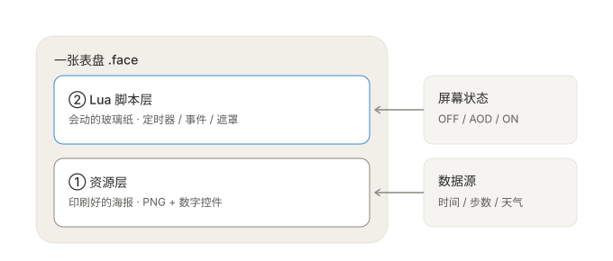
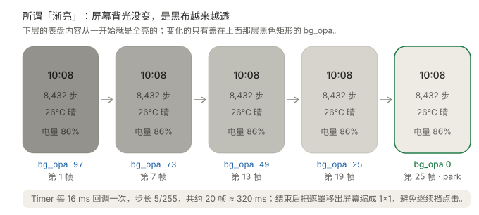
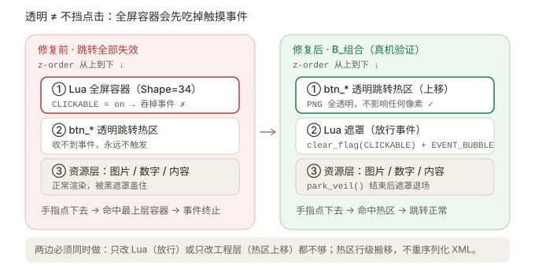
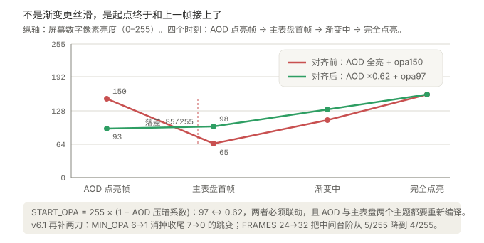
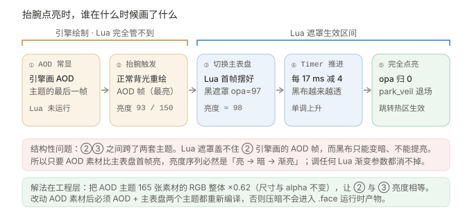

# 小米手环 9 Pro 表盘 · 完美亮度渐显

> 资源型 `.fprj` 表盘 + Lua 黑遮罩的无缝亮屏实践：从「点亮先闪黑 / 先闪亮再变暗」到亮度单调上升，且完整保留原生跳转点击。

这是一份 **WorkBuddy Skill，也是一份可独立阅读的技术笔记**。全部内容基于小米手环 9 Pro（336×480，VelaOS）真机验证，适用于小米手环 8 Pro / 9 Pro 及同代 Pro 系列。

---

## 一句话结论

**不是渐变做得更丝滑了，是渐变的起点终于和上一帧接上了。**

Lua 没有调节背光的接口，所谓「缓慢亮屏」只是盖一层全屏黑布再逐帧掀开。而抬腕点亮的第一帧由引擎绘制 AOD 主题，Lua 遮罩盖不住它 —— 所以真正的解法不在 Lua 参数里，而在工程层：**把 AOD 素材整体压暗，让 AOD 点亮帧与主表盘遮罩首帧亮度相等**。

| 阶段 | AOD 点亮瞬帧 | 主表盘首帧 | 落差 |
| --- | --- | --- | --- |
| 最初（`START_OPA=150`，AOD 原始亮度） | 150 | 65 | **85 / 255 ≈ 33%**（明显下凹） |
| 最终（`START_OPA=97`，AOD ×0.62） | 93 | 98 | **5 / 255 ≈ 2%**（单调上升） |

---

## 图解



**图 1 · 两层结构**：资源层是「印刷好的海报」，Lua 层是「会动的玻璃纸」。两者不是二选一，而是同一个表盘容器里的不同部分。



**图 2 · 渐亮原理**：屏幕背光始终没变，是盖在上面的黑布从 97/255 逐帧降到 0。



**图 3 · 点击修复**：全屏遮罩即使透明也会吃掉触摸事件，必须「Lua 放行 + 工程层把热区排到上面」组合处理。



**图 4 · 亮度对齐**：红线是「亮 → 暗 → 渐亮」的下凹，绿线是压暗 AOD 后的单调上升。



**图 5 · 点亮时序**：谁在什么时候画了什么，一眼看清 Lua 管不到的那一段。

---

## 快速开始

> 前置：已有一个 EasyFace / Mi-Create 能编译的 `.fprj` 工程；渐亮脚本从 [NineBomb/SmoothlyLight-9](https://github.com/NineBomb/SmoothlyLight-9) 获取（AGPL-3.0）。

```bash
# 1. 注入 Lua 图层（Shape=34 容器），并修好点击层序
python scripts/add_lua_layer.py <工程目录> --lua /path/to/SmoothlyLight.lua
python scripts/fix_click_after_lua.py <工程目录>

# 2. 压暗 AOD 素材并同步 Lua 的 START_OPA
python scripts/dim_aod_assets.py <工程目录> --factor 0.62 --sync

# 3. 静态自检
python scripts/verify_project.py <工程目录>
```

4. 用 EasyFace / Mi-Create **重新编译 AOD 与主表盘两个主题**（关闭并重新打开工程，别用旧会话）。
5. 推送新生成的 `.face` 到设备，验证：点亮无亮度回落、渐显可见、原有跳转全部正常。

---

## 三条铁律

1. **遮罩只能变暗，不能提亮。** Vela 的 `screen` 模块经设备验证为空表，`lvgl.disp` 只有 `set_bg_opa` 等背景属性，没有背光 API。
2. **Lua 盖不住引擎画的 AOD 帧。** 消除跳变的唯一办法是让两帧亮度相等，而不是调渐变曲线。
3. **`START_OPA = 255 × (1 − AOD 压暗系数)`。** 默认 `97 ↔ 0.62`，两者必须联动，且改动 AOD 素材后必须两个主题都重新编译。

---

## 文档目录

| 文档 | 内容 |
| --- | --- |
| [01 · Lua 与表盘运行原理](references/01-lua-basics.md) | 两层结构、事件回调 / Timer / 对象、状态字符串、API 边界、Lua 图层如何打包 |
| [02 · 渐亮脚本原理](references/02-fade-principle.md) | 原版脚本逐行解读、黑遮罩本质、点亮时序、参数含义 |
| [03 · 修复完整复盘](references/03-fixes.md) | 路线共存、首帧时序、点击失效、亮度跳变，以及 v4/v5 两次失败方案 |
| [04 · 参数调优与排错](references/04-tuning.md) | 参数档位、配对公式、症状→原因→处理清单、编译注意事项 |
| [05 · 致谢与出处](references/05-sources.md) | **全部参考脚本 / 教程的原作者、链接与许可证** |
| [06 · 亮屏所需的最小背景](references/06-ecosystem.md) | 分层认知、三条路线、AOD 独立主题、重编译规则 |
| [scripts/](scripts/README.md) | 4 个亮屏链路上的可复用 Python 工具 |

> **仓库范围**：只沉淀「亮屏逻辑、优化点与配套修复」。解包 / `bin`→`.fprj` 转换 / 预览渲染那套工具属于另一条工作流，**不在本仓库内**；需要的是一份已经能编译的 `.fprj` 工程。

---

## 主要参考（完整清单见 [05](references/05-sources.md)）

| 项目 | 作者 | 用途 | 许可证 |
| --- | --- | --- | --- |
| [SmoothlyLight-9](https://github.com/NineBomb/SmoothlyLight-9) | **NineBomb** | 渐亮原脚本、Lua 图层放最顶层的说明 | AGPL-3.0 |
| [EXMars](https://github.com/NineBomb/EXMars) | **NineBomb** | `OFF` / `IDLE` 状态字符串实证、`EVENT_BUBBLE` | AGPL-3.0 |
| [Lua_MiBand9Pro](https://github.com/LeeKLong/Lua_MiBand9Pro)（`fade-bright`） | **LeeKLong** | `ease_out`、熄屏预置遮罩、关闭点击 | AGPL-3.0 |
| [Vela_Application_Documentation](https://github.com/FangAiden/Vela_Application_Documentation) | **FangAiden** | Lua / LVGL API 文档，证实无亮度接口 | 见仓库 |
| [EasyFace](https://github.com/m0tral/EasyFace) | **m0tral** | 表盘编辑器与 Gen2 编译器 | 见仓库 |
| [Mi-Create](https://github.com/ooflet/Mi-Create) | **ooflet** | `.fprj` 编辑器 | GPL-3.0 |

---

## 许可证与合规

- 本仓库**原创**的文档、SVG 图解与 Python 工具：MIT（见 [LICENSE](LICENSE)）。
- 渐亮 Lua 脚本及其修改版：衍生自 **NineBomb** 的 AGPL-3.0 作品，**须遵循 AGPL-3.0**。本仓库不分发完整 Lua 文件，仅引用少量片段用于讲解，请到原仓库获取完整脚本。引用片段的版权归各自作者所有。

如果这份笔记帮到了你，去给上面几个原项目点个 star —— 没有他们的开源，就没有这套方案。
