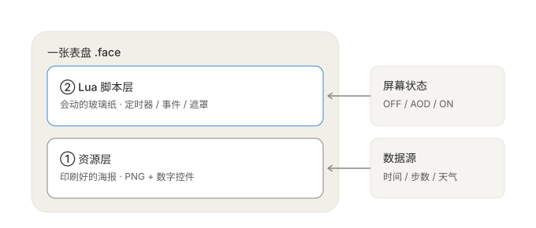

# 01 · Lua 与表盘运行原理

> 面向完全没接触过 Vela 表盘开发的人。读完这一篇，就能看懂渐亮脚本在干什么。

## 1. 先分清楚四个「层」

刚接触小米表盘时最容易被 `bin`、`face`、`fprj`、`Lua` 这些词绕晕。其实它们分属两个不同的层：

| 层 | 文件 | 谁在看 | 说明 |
| --- | --- | --- | --- |
| **运行层** | `.face` / `.bin` | 手环固件 | 编译产物，推送到设备的就是它 |
| **工程层** | `.fprj`（XML + `images/` + `AOD/`） | EasyFace / Mi-Create | 最主流的可编辑工程，本项目的主角 |
| **代码层** | `app/_lua/*.lua` | 固件里的 Lua 解释器 | **Lua 图层**，运行时执行的脚本，本项目的渐亮就在这里 |
| **代码层** | `app/lua/main.lua` | 固件里的 Lua 解释器 | 纯 Lua 表盘的入口（另一种路线，本仓库不涉及） |

一句话：**`.fprj` 是你写的东西，`.face` 是编译给手环看的东西，Lua 是可以在运行时动手脚的那一层。**

## 2. 一张表盘 = 海报 + 玻璃纸



**资源层（印刷好的海报）**：`.fprj` 里是一堆 `<Widget>` 描述 —— 静态图片（`Shape=30`）、图片列表（`31`，用于逐帧动画或数字位图）、数字控件（`32`）、Lua 容器（`34`）。引擎自己会按数据源把时间、步数、天气贴上去，**完全不需要写代码**。数字控件只要声明 `Value_Src="821"`（步数）和 `Digits="5"`，固件就会自动填数。

**Lua 层（会动的玻璃纸）**：一个覆盖全屏的对象，加上一段运行时脚本。它能做出资源层做不到的效果 —— 逐帧改变透明度、响应抬腕、按时间算动画。

**两者不冲突**：Lua 图层只是 `.fprj` 里的一个 `Shape="34"` 控件，编译器会把它引用的 `.lua` 打包进二进制的 Block 5（App Data），同时在 Block 0（Elements）生成一条容器元素。下层原有的图片、数字、跳转热区照常编译。所以「资源型表盘」和「Lua 表盘」不是二选一。

> **注意区分**：`FangAiden/LuaDevTemplate` 是**纯 Lua 表盘**（`app/lua/main.lua` 作为入口，整个界面用代码画出来），适合从零做全 Lua 表盘；本项目用的是 `app/_lua/` **Lua 图层**，目的是在保留原表盘所有控件的前提下加一个效果。两者目录结构不同，别混用。

## 3. Lua 解释器到底在干什么

Lua 是一种轻量脚本语言，**不编译成机器码**，由手环固件里的小解释器在运行时逐句执行。表盘脚本只做三类事情，理解这三类就够了：

### 3.1 收事件：引擎主动喊你

```lua
function ScreenStateChangedCB(pre, now, reason)
    -- pre: 变化前的状态   now: 变化后的状态
end
```

屏幕状态一变，固件就调用这个函数。这是脚本唯一的「输入口」，渐亮脚本靠它知道「该开始动画了」。

**状态字符串没有官方文档，下面是社区真机项目里实证出来的**：

| 状态 | 含义 | 出处 |
| --- | --- | --- |
| `OFF` | 屏幕全黑 | `NineBomb/EXMars` · `SmoothlyLighttop/SmoothlyLight.lua`：`pre == "OFF" and now == "ON"` |
| `IDLE` | 息屏显示（屏幕还亮着） | `NineBomb/EXMars` · `SmoothlyLightmiddle/SmoothlyLight.lua`：`pre == "IDLE" and now == "ON"`，以及 `mars3/smash.lua` 中 `if now == "IDLE"` 暂停动画 |
| `AOD` | 息屏显示（另一套固件命名） | `sigmayl/MiBandBLE` · `tests/display.lua` 的生命周期测试：`('OFF','AOD')` → `('AOD','ON')` |
| `ON` | 正常点亮 | 上述项目通用 |

不同固件版本可能把息屏报成 `IDLE`、`AOD` 或其它变体，所以健壮的脚本应该用关键字模糊匹配，而不是只认一个字符串。

### 3.2 设闹钟：Timer 驱动每一帧

```lua
orderedTimer = lvgl.Timer({
    period = 16,              -- 每 16ms 回调一次
    cb = function(t) ... end
})
```

手环没有「播放动画」这种高级接口，动画就是定时器每 16ms 改一次属性，靠人眼视觉暂留连成动画。`orderedTimer:pause()` / `:resume()` 控制启停。

社区里也有用 `lvgl.Anim` 的写法（`LeeKLong/Lua_MiBand9Pro` 的 `fade-bright`），支持 `path = "ease_out"` 缓动曲线，但需要确认目标固件支持该模块。

### 3.3 改对象：LVGL 的属性

LVGL 是手环用的嵌入式图形库。`lvgl.Object(nil, {...})` 创建一个对象，`scr:set({bg_opa = ...})` 修改属性。

| 属性 / 方法 | 作用 |
| --- | --- |
| `w = lvgl.HOR_RES()`, `h = lvgl.VER_RES()` | 铺满屏幕（9 Pro 为 336×480） |
| `bg_color = 0` | 黑色 |
| `bg_opa = 0..255` | 背景不透明度，255 = 完全不透明 |
| `border_width = 0`, `pad_all = 0` | 去掉边框和内边距 |
| `lvgl.FLAG.HIDDEN` | 隐藏对象 |
| `lvgl.FLAG.CLICKABLE` | 对象可接收点击（**渐亮遮罩必须关掉**，见 03） |
| `lvgl.FLAG.EVENT_BUBBLE` | 事件继续向下传递 |

## 4. 一个关键边界：Lua 调不了背光

这是整套方案最重要的物理限制，也是所有痛苦的根源。查 `FangAiden/Vela_Application_Documentation` 可以确认：

- `docs-lua/screen/overview.md` 明确写着：

  > 设备验证结果：空表，无可用方法。`print(type(screen)) --> "table"`，`pairs(screen)` 无输出。

  也就是说 `screen` 模块在这台设备上是个空壳。

- `docs-lua/lvgl/modules/disp.md` 列出的显示设备 API 只有 `get_default` / `get_next` / `get_scr_act` / `load_scr` / `set_bg_opa` / `set_bg_color` / `set_bg_image` / `set_rotation` 等。**没有任何亮度、背光、gamma 接口**。`disp:set_bg_opa()` 改的是 LVGL 默认屏幕的背景不透明度，不是硬件背光。

- 同一文档里 `lvgl.disp.load_scr()` 支持 `anim = "fade_on"` / `"fade_in"` 屏幕切换动画，看起来像现成的渐显。但它是 **Lua 主动切换两个 screen 对象** 时用的，而 AOD → 主表盘的切换由**引擎**完成，脚本插不进手，所以这条路救不了本项目的问题。

**结论：Lua 无法把屏幕「慢慢调亮」，只能把画面「慢慢盖浅」。** 这就是下一章「假渐亮」的由来。

## 5. Lua 图层是怎么进 `.face` 的

`.fprj` 里的容器长这样（以 9 Pro 为例）：

```xml
<Widget Shape="34" Name="app__lua%2FSmoothlyLight.lua"
        X="0" Y="0" Width="336" Height="480" Alpha="0" Visible_Src="0" />
```

几个容易踩的点：

- `Shape="34"` 是「基础容器 / Lua 容器」的固定编号。
- `Name` 里的 `%2F` 是 URL 编码的 `/`，指向工程内 `app/_lua/` 下的相对路径。
- **放在 `<Screen>` 内最后一个 `<Widget>` = 最顶图层**。原作者 README 明确要求「请把 lua 图层放在最顶层」。但这恰恰是点击失效的原因，见 03。
- Lua 文件名必须 ASCII（英文 / 数字 / 下划线），中文或空格会导致编译失败。同理，工程目录也建议全 ASCII —— EasyFace 在中文路径下会读不到文件，实测需要把工程目录改成 `face` 之类的名字。
- 编译器会把 `.lua` **明文**打包进 `.face`，所以可以直接在编译产物里搜 `ScreenStateChangedCB` 来确认打包的是哪一版脚本。这个技巧在排查「改了脚本但没生效」时非常好用。

## 6. 运行时坑位速记

| 坑 | 表现 | 处理 |
| --- | --- | --- |
| 用了被裁剪的标准库 | 整个脚本不生效、没有任何动画 | 避免 `string.upper` / `string.find` 等调用；只用 `math.*` 和 LVGL 已验证 API |
| GUI 内存里的旧工程回写 | 磁盘上明明改了，编译产物还是旧的 | 关闭并重新打开 `.fprj` 再编译 |
| AOD 主题没跟着重打包 | 参数改了但观感几乎不变 | 凡是改了 AOD 素材，两个主题都要重新编译 |
| 编译产物里的旧 `.face` | 真机效果与预期不符 | 推送前确认时间戳，只用本次新产物 |
| `BitmapList` 末尾多一个 `\|` | 报错 `unable to open image '...\images\'` | 编译器把空文件名拼成了目录路径；按字节去掉空项即可（`verify_project.py` 可自动查出） |

---

下一篇：[02 · 渐亮脚本原理](02-fade-principle.md)
