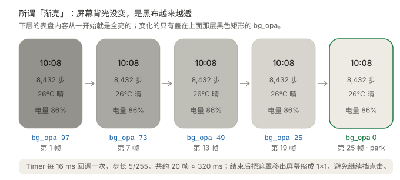
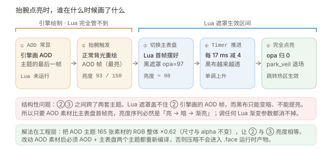

# 02 · 渐亮脚本原理

> 原脚本来自 **NineBomb / [SmoothlyLight-9](https://github.com/NineBomb/SmoothlyLight-9)**（AGPL-3.0）。本节引用其核心片段用于讲解，版权归原作者所有；完整文件请到原仓库获取。

## 1. 原版脚本在做什么

原版 `SmoothlyLight.lua` 只有 789 字节，核心逻辑节选如下（变量名按原样保留）：

```lua
local lvgl = require("lvgl")
local img_index = 255
scr = lvgl.Object(nil, {
        w = lvgl.HOR_RES(),
        h = lvgl.VER_RES(),
        bg_color = 0,
        bg_opa = 0,
        border_width = 0,
        pad_all = 0
    })
orderedTimer = lvgl.Timer({
        period = 17,
        cb = function(t)
            scr:set({ bg_opa = img_index })
            img_index = img_index - 10
            if img_index < 6 then
                orderedTimer:pause()
                scr:add_flag(lvgl.FLAG.HIDDEN)
            end
        end,
    })
function ScreenStateChangedCB(pre, now, reason)
    if pre ~= "ON" and now == "ON" then
        img_index = 255
        scr:clear_flag(lvgl.FLAG.HIDDEN)
        orderedTimer:resume()
    end
end
return
```

逐行拆开看：

| 代码 | 含义 |
| --- | --- |
| `local img_index = 255` | 当前「黑度」，255 = 全黑 |
| `lvgl.Object(nil, {...})` | 创建一块铺满全屏的黑色矩形，初始 `bg_opa = 0`（透明，看不见） |
| `lvgl.Timer({period = 17, ...})` | 每 17ms 把 `bg_opa` 设成 `img_index`，然后 `img_index = img_index - 10` |
| `if img_index < 6 then ...` | 黑度降到 6 以下就暂停定时器、把遮罩隐藏，动画结束 |
| `ScreenStateChangedCB` | 只要「从非 ON 变成 ON」，就把黑度重置为 255、显示遮罩、启动定时器 |
| `return` | 脚本交给引擎接管，之后只靠回调驱动 |

整个动画就是：**点亮 → 盖全黑 → 每 17ms 减 10 → 约 25 帧 / 425ms 后全透明**。

## 2. 这是「假渐亮」



屏幕的**硬件背光自始至终没有变过**。变的是盖在画面上那层黑布的不透明度：

```
观感亮度 ≈ 原始画面亮度 × (1 − bg_opa / 255)
```

- `bg_opa = 255` → 画面全黑；
- `bg_opa = 97` → 画面剩下约 62% 亮度；
- `bg_opa = 0` → 画面 100% 显示。

所以「从暗到亮渐显」实际上是「从黑到透明」。这个认知决定了两件事：

1. **遮罩只能让画面变暗，永远不能提亮。**
2. **遮罩只画在主表盘上**，AOD 主题是引擎独立绘制的，它盖不到。

这两条合起来，就是后面所有亮度跳变问题的物理根源。

## 3. 参数含义

改造后的脚本把散落的魔法数字收拢成常量：

| 常量 | 当前值 | 作用 |
| --- | --- | --- |
| `START_OPA` | `97` | 渐显起点的黑度。决定主表盘首帧有多暗，**必须与 AOD 压暗系数配对** |
| `FRAMES` | `32` | 目标帧数。实际步长 `step = ceil(START_OPA / FRAMES)`，所以 `32 → step=4` |
| `PERIOD` | `17` | 定时器周期（ms），即每帧时长 |
| `MIN_OPA` | `1` | 收尾阈值。黑度低于它就归零并 `park_veil()` |

**一个容易忽略的细节**：`FRAMES=24` 时 `step = ceil(97/24) = 5`，实际序列是 `97, 92, …, 7` 共 **19 帧**（不是 24 帧）；配合旧的 `MIN_OPA=6`，最后一帧会从 `7` **直接跳到 0**，这一跳（2.7%）比中间每帧台阶（2%）还大 —— 观感上就是「收尾突然亮一下」。改成 `FRAMES=32 / MIN_OPA=1` 后变成 25 帧、台阶 4/255、末帧 `1→0`（0.4%），平滑得多。

## 4. 点亮到底发生了什么



一次抬腕点亮可以拆成四段：

| 时刻 | 谁在画 | 画了什么 | Lua 能否干预 |
| --- | --- | --- | --- |
| ① 抬腕前 | 引擎 | AOD 主题，低亮度显示 | 否 |
| ② 点亮瞬间 | **引擎** | 用正常背光重绘 **AOD 最后一帧** | **否，关键** |
| ③ 切换主题 | 引擎 + Lua | 切到主表盘，Lua 摆好遮罩（`bg_opa = START_OPA`） | 是 |
| ④ 渐变中 | Lua | Timer 每 17ms 减一点黑度，直到归零并 `park_veil()` | 是 |

第 ② 帧是整件事的胜负手。它的亮度完全由 **AOD 素材的像素值** 决定，Lua 碰不到。第 ③ 帧则被遮罩压暗。于是：

```
亮度序列 = AOD 帧亮度  →  主表盘首帧亮度  →  逐帧上升  →  全亮
              ↑引擎决定        ↑START_OPA 决定
```

只要前者 > 后者，中间必然出现一次**亮度下凹**（先亮一下、再暗下去、再慢慢亮起来）。用户看到的「先闪一下最亮的 AOD，再从最暗开始渐显」就是它。

## 5. 社区改良版提供了哪些思路

调研时找到几个很有价值的真机项目，它们的做法后来都用在了修复里：

### `LeeKLong/Lua_MiBand9Pro` → `src/fade-bright/main.lua`（AGPL-3.0）

```lua
-- 显式关闭点击，并开启事件冒泡
ui.mask:clear_flag(lvgl.FLAG.CLICKABLE)
ui.mask:add_flag(lvgl.FLAG.EVENT_BUBBLE)

-- 用 lvgl.Anim 做缓动，而不是手写 Timer
ui.fadeAnim = lvgl.Anim(ui.mask, {
    start_value = 255, end_value = 0,
    duration = 500, path = "ease_out", ...
})

-- 熄屏时预置遮罩，为下次亮屏做准备
ui.fadeAnim:stop()
ui.mask:set({ bg_opa = 255 })
```

三个可复用的点：**关闭遮罩点击 + 事件冒泡**（点击修复的 Lua 侧）、**ease_out 缓动曲线**（比线性更顺）、**熄屏时预置遮罩**（避免点亮首帧来不及盖黑布）。它还用 `activity.isShown({appID = 2, pageID = 2})` 判断表盘编辑态，避免编辑预览被遮罩干扰，很细致。

### `NineBomb/EXMars` → `resources/_lua/SmoothlyLighttop|middle`

两个变体分别只对 `pre == "OFF"` 和 `pre == "IDLE"` 触发渐亮，说明作者按唤醒来源做过分流；`middle` 版还加了 `s:add_flag(lvgl.FLAG.EVENT_BUBBLE)`。本项目 v4 曾照这个思路做过状态分流，结果把动画砍没了（见 03）。

### `sigmayl/MiBandBLE` → `tests/display.lua`

它的生命周期测试直接以 `('OFF','AOD')` → `('AOD','ON')` 驱动 `ScreenStateChangedCB`，是状态字符串最可靠的交叉验证。

## 6. 小结

- 渐亮 = 掀黑布，不是调背光。
- 遮罩只能变暗，且只能盖主表盘。
- 点亮第一帧属于引擎，不属于 Lua。
- 因此「完美渐显」的关键不在曲线，而在**让 AOD 帧与主表盘首帧亮度相等**。

具体怎么对齐、为什么前几轮改 Lua 全都无效，见 [03 · 修复完整复盘](03-fixes.md)。

---

上一篇：[01 · Lua 与表盘运行原理](01-lua-basics.md) · 下一篇：[03 · 修复完整复盘](03-fixes.md)
