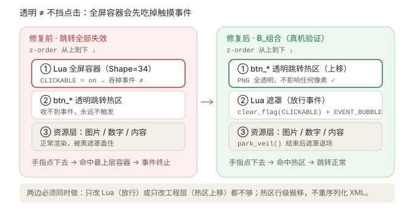
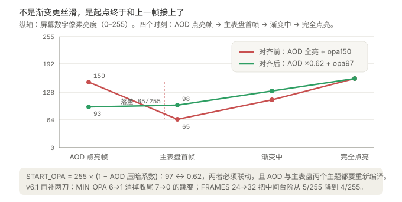

# 03 · 修复完整复盘

> 这一篇记录从「能挂上」到「完美渐显」踩过的每一个坑。按时间顺序读，能明白为什么前几轮改 Lua 参数全都无效。

## 版本演进一览

| 版本 | 改动 | 用户实测结果 |
| --- | --- | --- |
| v1 | 注入 Lua 图层，原版脚本 | 有动画，但 AOD 点亮先闪一帧黑 |
| v2 | 首帧时序修复 + `START_OPA=150` | 黑闪没了，变成「先闪一下最亮的 AOD，再从最暗渐显」 |
| v3 | AOD 素材 ×0.62 + `START_OPA=97` | **有渐显、无明显跳变**，但点击跳转全失效 |
| B_组合 | 点击修复（Lua 侧 + 工程层） | **跳转全部恢复正常** |
| 终版 | AOD 与主表盘两个主题都重新编译 | **亮度跳变基本消失** |
| v4 | 状态分流：AOD 点亮直接全亮 | ❌ **动画彻底没了** |
| v5 | AOD 点亮改浅渐变 `START_LIT=55` | ❌ 渐显幅度小到看不见 |
| v6 | 回滚到 v3 代码 + AOD ×0.62 | ✅ 动画与点击都恢复 |
| v6.1 | `FRAMES 24→32`、`MIN_OPA 6→1` | ✅ 收尾跳变消失，过渡最平滑（425ms） |
| v6.2 | `FRAMES 32→24`、`PERIOD 17→16` | ✅ 425ms→320ms，快约 25%，亮度衔接与收尾手感不变 |

## 修复一 · 让 Lua 图层和资源型控件共存

起初担心「资源型 `.fprj`」和「Lua 表盘」是两条互斥路线。查证后确认不冲突：`Shape="34"` 的 Lua 容器只是 `.fprj` 里的一个控件，编译器把脚本打包进 `.face` 的 Block 5，下层控件照常编译。

工具 `scripts/add_lua_layer.py` 做三件事：

1. 把 `.lua` 复制到工程 `app/_lua/` 下，并把文件名净化成 ASCII；
2. 生成 `Shape="34"` 容器，追加到 `<Screen>` 末尾（最顶图层）；
3. 保持原文件的编码 / BOM / CRLF / 属性顺序（按字节读写，不重序列化 XML），并留 `.bak`。

**幂等性设计**：重复注入时先移除旧容器；若工程已做过点击修复（热区排在 Lua 容器之上），重注入时会把新容器插到热区**之前**，避免层序被打乱、跳转再次失效。这个细节后来返工过一次，值得留意。

## 修复二 · 首帧时序（消除「闪一帧黑」）

**现象**：从 AOD 点亮后先闪一下黑屏，再从暗到亮渐显。

**原因**：原版在 `ScreenStateChangedCB` 里只做了 `resume()`，遮罩的 `bg_opa` 要等 Timer **第一次回调**才被设置。点亮那一帧遮罩处于什么状态是不确定的，于是出现一帧异常画面。

**改法**：

```lua
-- 先摆好遮罩，再显示它；Timer 创建后立即暂停
scr:set({ bg_opa = START_OPA, x = 0, y = 0, w = W, h = H })
scr:clear_flag(lvgl.FLAG.HIDDEN)
orderedTimer:pause()
```

同时把「非 ON 状态」统一处理成 `bg_opa = 0` + 隐藏，避免残留遮罩影响下一次唤醒。改完黑闪消失。

## 修复三 · 点击跳转全部失效（真机验证的组合方案）

**现象**：加了缓亮后，表盘上 5 个跳转按钮全部点不动。

**原因**：那层全屏遮罩即使透明，在 LVGL 里仍是一个**默认可点击的对象**，而且被要求放在最顶图层。触摸命中按 z-order 自顶向下匹配，手指事件被遮罩先吃掉，下面的 `btn_*_RGBA` 热区收不到。

原作者其实已经在 README 里写明：

> ps：2.0版本暂时不支持下属表盘的点击事件，且未发布1.0版本
> —— [NineBomb/SmoothlyLight-9](https://github.com/NineBomb/SmoothlyLight-9)



**解法必须两边同时做**（单独任一边都无效，故称「组合」）：

### Lua 侧

```lua
scr:clear_flag(lvgl.FLAG.CLICKABLE)   -- 遮罩不再接收点击
scr:add_flag(lvgl.FLAG.EVENT_BUBBLE)  -- 事件继续向下传递

-- 渐变结束后把遮罩移出屏幕、缩成 1×1，彻底不挡
local function park_veil()
    scr:set({ bg_opa = 0, x = -10, y = -10, w = 1, h = 1 })
    scr:add_flag(lvgl.FLAG.HIDDEN)
end
```

用 `pcall` 包住 flag 操作，兼容裁剪过 API 的固件。这个做法与 `LeeKLong/Lua_MiBand9Pro` 的 `fade-bright` 一致，也与 `NineBomb/EXMars` 的 `SmoothlyLightmiddle` 里 `add_flag(EVENT_BUBBLE)` 一致。

### 工程侧

`scripts/fix_click_after_lua.py` 把所有 `btn_[...]` 热区 Widget **行级搬移**到 Lua 容器之后（更顶层）。热区图通常是 100% 透明的 RGBA（实测 alpha 全 0），所以：

- **渲染**：内容控件仍在 Lua 遮罩之下，黑布依旧盖得住画面；透明热区叠在最上层不改变任何像素。
- **命中**：热区变成最顶层，点击优先落在热区上，跳转恢复。

工具只读文本、搬整行，不重新序列化 XML，保留 BOM / 编码 / 属性顺序；支持 `--check` 幂等检查与 `--restore` 还原。

> 真机验证结果：**`B_组合` 方案 5 个跳转全部恢复正常**。

## 修复四 · 亮度跳变（最关键的一步）

### 现象的三轮演变

1. 先闪一帧黑屏，再渐亮；
2. 黑闪修好后 → 先闪一下**最高亮度的 AOD**，再从**最小亮度**的正式表盘开始渐显；
3. 又有「短暂的突变暗」。

### 结构性原因

AOD 与主表盘是**两套独立主题**（各有自己的 `images/` 和 `.fprj`）。抬腕点亮时：

1. 引擎先用正常背光重绘 **AOD 最后一帧**；
2. 再切换到主表盘，此时 Lua 遮罩才生效。

Lua 遮罩**盖不住第 1 步那一帧**，而且**只能变暗不能提亮**。所以只要 AOD 素材比主表盘首帧亮，亮度序列必然是「亮 → 暗 → 渐亮」，中间那个下凹无法通过任何 Lua 参数消除。



### 量化

数字帧为纯白 255 / alpha 148，AOD 底色约 3.9、主表盘底色约 26：

| | AOD 点亮瞬帧 | 主表盘首帧 | 落差 |
| --- | --- | --- | --- |
| `START_OPA=150` + AOD 原始亮度 | 149.6 | 65.4 | **84 / 255 ≈ 33%** |
| `START_OPA=97` + AOD ×0.62 | 92.8 | 98.5 | **−5.7 / 255 ≈ 2%** |

### 真正生效的改动：在工程层，不在 Lua

`scripts/dim_aod_assets.py` 把 AOD 主题的全部素材（实测 165 张）**从一份原始素材副本重新生成**（首次运行自动建立 `AOD/images_original/`，也可用 `--source` 指向自己的原始素材），RGB 整体乘以 `factor`，**alpha 与尺寸逐字节保持不变**：

```python
r, g, b, a = im.split()
lut = [round(i * factor) for i in range(256)]
im = Image.merge("RGBA", (r.point(lut), g.point(lut), b.point(lut), a))
```

- 白数字从 255 降到 158，AOD 点亮瞬帧亮度降到约 93；
- 同时把 Lua 的 `START_OPA` 设为 `255 × (1 − 0.62) = 97`，主表盘首帧约 98；
- 两帧几乎相等 → 亮度曲线从 AOD 帧开始单调上升，没有下凹。

工具是**幂等**的（每次都从原始副本重新生成，不会越压越暗），`--factor 1.0` 可完整还原，`--sync` 自动同步 Lua 的 `START_OPA`，`--compare` 生成亮度衔接曲线图。

### 为什么之前「改善一点但不够丝滑」

**压暗改动只落在磁盘素材上，必须把 AOD 主题也重新编译才会进入运行时 `.face`。** 前几轮只改 Lua、只重编译主表盘，AOD 主题仍是原始亮度，压暗根本没生效。用户按说明把两个主题都重编译后，跳变才真正消失。

> 排查技巧：在编译产物 `.face` 里搜 `ScreenStateChangedCB` 能确认打包的是哪一版 Lua；用 PIL 量一下 `AOD/images/img_0007_0.png` 的白色峰值（158 = 已压暗，255 = 原始）能确认素材是否生效。

### 两次失败方案，别再走

| 版本 | 思路 | 为什么失败 |
| --- | --- | --- |
| **v4** | 状态分流：AOD / IDLE 点亮直接全亮，只有真熄屏才缓亮 | 等于把渐显整个删了 —— **动画彻底没有**。另外引入了 `string.upper/find`，这类库在固件上可能被裁剪，会让脚本整体不生效 |
| **v5** | AOD 点亮改用很淡的遮罩 `START_LIT=55`，想缩小落差 | 渐显全程只有约 `125→159`（34/255）的变化，加上点亮首帧遮罩已就位（一进来就是暗的），**观感上等于没有渐显** |

共同规律，也是这套架构的硬约束：

> **AOD 素材全亮 + 想消除跳变 ⇒ 遮罩必须很淡 ⇒ 渐显必然看不见。**
> 纯 Lua 层没有第三种解法：遮罩盖不住引擎画的 AOD 帧，也做不到物理提亮。

### v6 / v6.1 收尾

- **v6**：代码逐字回到真机验证过「有渐显 + 5 个跳转正常」的 v3 逻辑，只重写注释头；删除 `arm_veil` / `last_state` / 状态分档，不用 `string.*`。AOD 素材恢复 ×0.62。两者必须成对。
- **v6.1**：只改两个常量，逻辑零改动：`MIN_OPA 6→1` 消掉收尾 `7→0` 的 2.7% 跳变；`FRAMES 24→32` 把步长 5→4、19 帧→25 帧，台阶从 5/255 降到 4/255。
- **v6.2**：425ms 偏慢，只把 `FRAMES 32→24`、`PERIOD 17→16`；`START_OPA=97`、`MIN_OPA=1`、AOD ×0.62 全部不动，因此亮度衔接与收尾手感不变。20 帧 / 320ms，台阶 4→5（2%），末帧仍是 `1→0`，没有重现 v6 的收尾突变暗。

## 工程层杂项修复

这些与渐亮原理无关，但都是实际推进中撞上的，一并记录：

| 问题 | 根因 | 处理 |
| --- | --- | --- |
| EasyFace 读不了工程 | 中文目录 / 中文文件名 | 工程目录改为纯 ASCII（如 `face`），对比图等中文名文件移出编译工程 |
| `unable to open image '...\images\'` | `BitmapList` 末尾多一个 `\|`，生成空文件名，被拼成目录路径 | 按字节去掉空项即可（生成工程时用 `\|`.join 前先过滤空串） |
| CLI 直调编译器报 `Array.Copy` 越界 | GUI 编译前会生成规范化的 `temp.fprj`，直接喂原始 fprj 走不通 | 用 GUI 编译；实测 GUI 可正常产出 `.face` |
| 数字去零左对齐 | 天气 / 电量 / 步数需要动态位数、不补前导零 | 对应 `Shape=32` 控件设 `Blanking="1"` + `Alignment="0"`；后缀 `xxx_ref[数字控件Name]` 会自动紧跟数字实际结束位置。**AOD 是独立 fprj**：只改主表盘不会同步 AOD，AOD 同名控件建议与亮屏同构（`Width` 用 5 位总框宽 110，而非单字符宽 22），改完两个主题都要重编译 |

## 最终稳定参数

> 当前 v6.2；回退到最平滑组合：`FRAMES=32`、`PERIOD=17`、`MIN_OPA=1`。

| 项 | 值 |
| --- | --- |
| `START_OPA` | `97` |
| AOD 素材亮度系数 | `0.62`（`255 × (1−0.62) = 97`） |
| `FRAMES` | `24` → `step=5`，20 帧 / 320ms（最平滑档位 `32`：step=4 / 25 帧 / 425ms） |
| `PERIOD` | `16` ms（≈60fps；v6.1 为 17） |
| `MIN_OPA` | `1` |
| fprj 层序 | 24 Widget；Lua 容器第 22 行，5 个 `btn_*` 热区全在其上 |
| 点击修复 | `CLICKABLE` 关闭 / `EVENT_BUBBLE` 开启 / 结束 `park_veil()` |

---

上一篇：[02 · 渐亮脚本原理](02-fade-principle.md) · 下一篇：[04 · 参数调优与排错](04-tuning.md)
